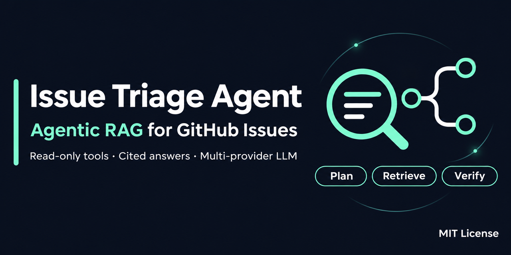
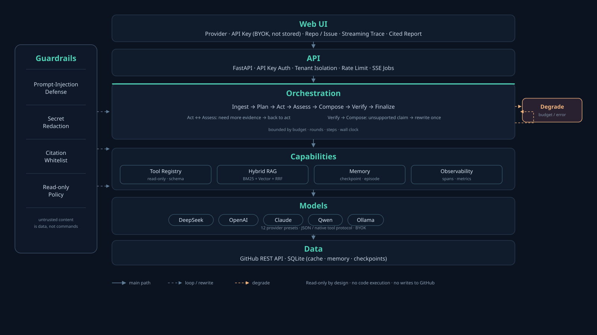
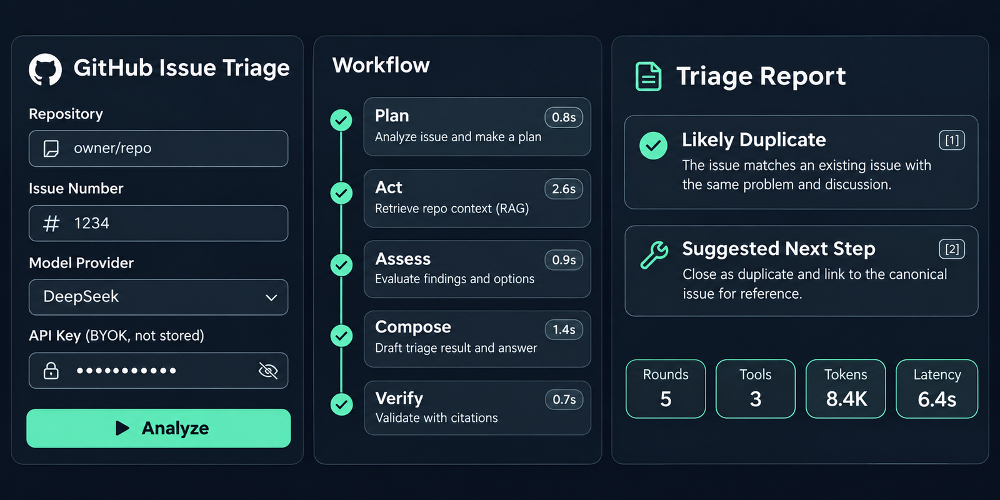

<p align="center">
  
</p>

<h1 align="center">GitHub Issue 排障 Agent（端到端 Agentic RAG 项目）</h1>

<p align="center">
  
</p>

> 输入一个 `owner/repo` + Issue 编号，Agent 自主读 Issue、规划检索、调用只读工具收集证据、
> 自我评估证据是否够用、写出带原始链接的排障假设，并在发布前用"审查员"剔除无依据结论。
> **只读**：不运行目标仓库代码、不修改 Issue/PR、不声称已修复。

技术栈：**Python 3.10+ / FastAPI / LangGraph / 多供应商 LLM（DeepSeek、OpenAI、Claude、
通义千问、Moonshot、智谱、Gemini、本地 Ollama/vLLM 等）/ GitHub REST API /
SQLite（缓存·记忆·检查点）/ 原生 HTML+SSE**。无需 Docker、Redis、向量数据库、GPU。

---

## 1. 业务问题与闭环

工程师排查线上报错时，真实动作是：读报错 Issue → 翻评论里的 workaround → 搜历史同类 Issue →
确认版本差异 → 形成假设 → 验证。这条链路的信息散落在 GitHub 的正文、评论、README、历史 Issue、
已合并 PR 中，人工做一次通常 20~60 分钟。

本项目把这条链路做成一个有边界的 Agent：

```
目标 Issue ──┬─ 评论（首尾抽样）──┐
             ├─ README ──────────┤
             └─ 历史 Issue/PR ───┘
                     │
               混合检索（BM25 + 向量 + RRF）
                     │
  规划 → 工具选择 → 证据评估 ─┬─ 不够 → 再检索（有上限）
                              └─ 够 → 写作 → 依据性审查 ─┬─ 不过 → 重写一次
                                                          └─ 通过 → 带引用报告
```

产物：结论摘要、分级置信度的可能原因、**每条结论的证据链接**、建议排查步骤、验证方式、
缺失信息清单、完整执行轨迹与成本指标。

---

## 2. 架构



<details>
<summary>同等内容的 ASCII 版本（便于纯文本环境阅读）</summary>

```
┌────────────────────────────── Web UI (index.html, SSE) ──────────────────────────────┐
│ 表单 → POST /api/v1/jobs → GET /api/v1/jobs/{id}/events（流式 trace）→ 报告 + 反馈     │
└───────────────────────────────────────┬──────────────────────────────────────────────┘
                                        │
┌─────────────────────────────── FastAPI 层 ───────────────────────────────────────────┐
│ API Key 鉴权 / 租户隔离 / 滑动窗口限流 / 请求 ID / 统一错误码 / /metrics / /readyz      │
└───────────────────────────────────────┬──────────────────────────────────────────────┘
                                        │
┌────────────────────────────── Agent 编排（LangGraph）────────────────────────────────┐
│ ingest → plan → act ⇄ assess → compose ⇄ verify → finalize                            │
│                     ↘ 预算耗尽 / 节点异常 → degrade（仍然给出可读结果）                 │
│ 预算守卫 · 循环守卫 · 引用白名单 · 越界表述拦截 · 检查点续跑                            │
└──────┬──────────────────┬──────────────────┬──────────────────┬──────────────────────┘
       │                  │                  │                  │
┌──────▼──────┐  ┌────────▼────────┐  ┌──────▼───────┐  ┌───────▼────────┐
│ 工具注册表   │  │ 混合检索 RAG    │  │ 长期记忆      │  │ 可观测性        │
│ 参数 Schema  │  │ chunk/BM25/向量 │  │ episode/fact │  │ span/metrics   │
│ 超时/去重/截断│  │ RRF/重排/去重   │  │ checkpoint   │  │ 结构化日志      │
└──────┬──────┘  └─────────────────┘  └──────────────┘  └────────────────┘
       │
┌──────▼──────────────────────────────────────────────────────────────────────────────┐
│ GitHub 只读客户端：ETag 条件请求 · TTL 缓存 · 分页 · 退避重试 · 限流识别 · 出口白名单  │
└─────────────────────────────────────────────────────────────────────────────────────┘
```

</details>

---

## 3. 技术栈落点（简历/面试可直接对照代码）

| 能力 | 本项目实现 | 代码位置 |
|---|---|---|
| Agent Loop / ReAct | 单步工具决策 + 观测回填 + 有界循环 | `issue_agent/agent/nodes.py` |
| Graph Engineering | LangGraph `StateGraph` + 条件路由 + 单一失败出口 | `issue_agent/agent/graph.py` |
| 结构化输出 | Pydantic 契约 + JSON 解析 + 带错误的修复重试 | `issue_agent/llm/client.py` `llm/schemas.py` |
| Tool Use / Function Calling | 工具注册表、JSON Schema 校验、`json`/`native` 双协议 | `issue_agent/tools/` |
| Agentic RAG | 模型自主决定何时检索、检索几次、换什么词 | `agent/nodes.py` `tools/kb_tools.py` |
| Hybrid Retrieval | 标题感知切块 + BM25 + 哈希向量 + RRF + 文档级去重 | `issue_agent/rag/` |
| Memory | 工作记忆/情景记忆/语义事实/检查点/反馈 四层 | `issue_agent/memory/store.py` |
| Context Engineering | 证据 ID/URL 注入、字符预算、不可信内容 nonce 隔离 | `issue_agent/agent/context.py` |
| Guardrails | 注入检测、密钥脱敏、引用白名单、越界表述改写、只读策略 | `issue_agent/security/` |
| 预算与降级 | Token/成本/调用数/轮次/墙钟六维预算，超限降级不崩溃 | `issue_agent/budget.py` |
| 可观测性 | Span 树、Prometheus 指标、JSON 日志、trace JSONL | `issue_agent/obs/` |
| 评测 | 离线数据集、Recall@k/MRR/引用有效率、回归门禁 | `issue_agent/eval/` |
| 服务化 | FastAPI + 异步作业 + SSE 断线重放 + 鉴权限流 | `issue_agent/api/` |
| 容错 | 条件请求缓存、指数退避、超时、幂等去重、检查点续跑 | `tools/github_tools.py` `cache.py` |

---

## 4. 快速开始

### 通用（Python >= 3.10）

```bash
python -m venv .venv
source .venv/bin/activate          # Windows: .venv\Scripts\activate
python -m pip install -r requirements.txt
cp .env.example .env               # Windows: Copy-Item .env.example .env
# 编辑 .env：选择 LLM_PROVIDER 并填对应 Key，强烈建议填 GITHUB_TOKEN
python -m issue_agent.cli doctor
python -m issue_agent.cli serve --host 127.0.0.1 --port 8000
```

打开 <http://127.0.0.1:8000>，示例 `idosal/git-mcp` / `214`（公开 Issue，随时可能变化）。

> 用 conda 也可以：`conda create -n issue-agent python=3.11 && conda activate issue-agent`。

### 4.1 选择大模型（12 家预设，改一个变量即可）

支持 DeepSeek、OpenAI、Anthropic Claude、通义千问、Moonshot、智谱 GLM、SiliconFlow、
OpenRouter、Gemini、本地 Ollama / vLLM，以及任意 OpenAI 兼容的自建端点。

```ini
# .env
LLM_PROVIDER=openai          # deepseek | openai | anthropic | qwen | moonshot | zhipu
                             # | siliconflow | openrouter | gemini | ollama | vllm | custom
OPENAI_API_KEY=sk-...        # 只填所选厂商对应的那一个 Key
LLM_MODEL=gpt-4o-mini        # 可选，留空用预设默认
```

| Provider | 协议 | 默认模型 | Key 变量 |
|---|---|---|---|
| `deepseek`（默认） | OpenAI 兼容 | `deepseek-flash` | `DEEPSEEK_API_KEY` |
| `openai` | OpenAI | `gpt-4o-mini` | `OPENAI_API_KEY` |
| `anthropic` | Messages API | `claude-sonnet-4-5` | `ANTHROPIC_API_KEY` |
| `qwen` | OpenAI 兼容 | `qwen-plus` | `DASHSCOPE_API_KEY` |
| `moonshot` | OpenAI 兼容 | `moonshot-v1-8k` | `MOONSHOT_API_KEY` |
| `ollama` | OpenAI 兼容 | `qwen2.5:7b` | 无需 |

完整的 Key 申请步骤、兼容性矩阵（JSON mode / tool calling / thinking）、
常见报错排查见 **[docs/PROVIDERS.md](docs/PROVIDERS.md)**。

### 4.2 申请 GitHub Token（强烈建议）

不配 Token 也能跑，但匿名只有 **60 次/小时**；配了 Token 后是 **5,000 次/小时**。

1. GitHub → 右上头像 → **Settings** → **Developer settings**；
2. **Personal access tokens → Fine-grained tokens → Generate new token**；
3. Repository access 选 **Public repositories (read-only)**；
4. Permissions 只给：**Issues: Read-only**、**Contents: Read-only**、**Metadata: Read-only**
   （可选 **Pull requests: Read-only**）；
5. 生成后复制 `github_pat_...` 到 `.env` 的 `GITHUB_TOKEN`。

验证：

```bash
python -m issue_agent.cli doctor
# 或
curl -s -H "Authorization: Bearer $GITHUB_TOKEN" https://api.github.com/rate_limit
```

> Token 只显示一次，请立刻保存；不要提交到 Git。详细步骤（含 classic token 方案与安全建议）
> 见 [docs/PROVIDERS.md#4-github-token-申请步骤重要](docs/PROVIDERS.md#4-github-token-申请步骤重要)。

### 4.3 在前端使用自己的模型 Key（BYOK）



<sub>界面示意图：左栏选择供应商并填 Key，中栏实时执行轨迹，右栏带引用的报告。</sub>

打开页面后可以直接选择供应商并填自己的 Key，**无需改服务端配置**：

1. **大模型供应商**：选 `OpenAI` / `Claude` / `通义千问` / `Ollama` 等（留空则用服务器默认）；
2. **API Key**：填对应厂商的 Key（仅随本次请求发送，**不落盘、不进日志、不进 trace**）；
3. **高级 → 模型名**：可选，留空用该供应商默认模型；
4. 点「开始分析」，报告顶部的指标会显示本次实际使用的 `provider / model`。

也可以通过 API 传：

```json
POST /api/v1/analyze
{
  "repo": "idosal/git-mcp",
  "issue_number": 214,
  "llm": {"provider": "openai", "model": "gpt-4o-mini", "api_key": "sk-..."}
}
```

安全约束：
- **不允许前端指定 base_url**（避免服务端被当成 SSRF 跳板），自建网关请用服务端 `LLM_BASE_URL`；
- 用户 Key 只在该次运行的 `Settings` 副本中存在，不写数据库、不写结果缓存、不写 trace；
- 选择其他供应商但没填 Key 时返回 **400** 并提示，而不是 500；
- 服务端限流仍然生效，防止 BYOK 被用来刷服务器资源。

### Docker（可选）

```bash
docker compose up --build      # 只监听 127.0.0.1:8000
```

### 命令行

```bash
python -m issue_agent.cli analyze --repo idosal/git-mcp --issue 214 --stream --out report.md
python -m issue_agent.cli eval --offline          # 离线评测（无需 Key/网络）
python -m issue_agent.cli doctor                  # 环境自检
```

---

## 5. HTTP API

| 方法 | 路径 | 说明 |
|---|---|---|
| POST | `/api/v1/analyze` | 同步分析，返回完整结果 |
| POST | `/api/v1/jobs` | 创建异步作业，返回 `job_id` |
| GET | `/api/v1/jobs/{id}` | 作业状态与结果 |
| GET | `/api/v1/jobs/{id}/events` | SSE 事件流（`Last-Event-ID` 可续传） |
| GET | `/api/v1/sessions` `/api/v1/sessions/{id}` | 历史会话（租户隔离） |
| POST | `/api/v1/sessions/{id}/resume` | 从检查点续跑 |
| POST | `/api/v1/feedback` | 👍/👎 + 评论，进入评测候选集 |
| GET | `/api/v1/meta` `/api/v1/stats` `/api/v1/eval/latest` | 配置/统计/最近评测 |
| GET | `/healthz` `/readyz` `/metrics` | 探针与 Prometheus 指标 |

鉴权：配置 `API_KEYS="key:tenant,key2:tenant2"` 后必须带 `X-API-Key`；未配置时仅允许本机访问。
错误统一为 `{"error":{"code","message","retryable"},"request_id"}`。

**重复请求复用**：同一 `(租户, 仓库, Issue, 补充信息, 模型, Prompt 版本)` 在
`RESULT_CACHE_TTL_S`（默认 900s）内直接返回缓存结果，并带 `cache.age_seconds`；
缓存未写入时的并发相同请求由 single-flight 合并为一次执行；运行中的异步作业按同一 key 去重。

---

## 6. 评测（可复现的数字）

```bash
python -m issue_agent.eval.runner --offline
```

当前离线结果（4 个**合成**样本、确定性 LLM 替身，验证的是流水线而非模型能力）：

| 指标 | 数值 | 含义 |
|---|---|---|
| Recall@5 | 0.833 | 标注的相关历史 Issue 进入前 5 的比例 |
| MRR | 1.000 | 第一个相关结果的排名倒数 |
| 引用有效率 | 1.000 | 引用 ID 必须真实存在（幻觉引用 = 0） |
| 引用覆盖率 | 1.000 | 有证据支撑的假设比例 |
| P50 / P95 延迟 | ≈1.0s / 1.2s | 含本地 SQLite 开销，不含真实模型推理 |
| 测试 | 99 个离线用例 | `python -m unittest discover -s tests -t .` |

真实链路冒烟（`idosal/git-mcp#214`，真实 GitHub + DeepSeek）：一次成功运行 **53s / 29.4k token /
14 次 LLM 调用 / 8 次工具调用 / 2 轮检索**，期间自动触发一次依据性重写。
完整报告见 [examples/sample-report.md](examples/sample-report.md)。

> 这组数字**不能**当作产品效果对外宣称。真实效果必须用 `--live` 在公开 Issue 上跑，
> 标注流程与门禁见 [docs/EVALUATION.md](docs/EVALUATION.md)。

---

## 7. 真实业务落地问题（摘要）

完整清单（30+ 条，含根因、解法、代码位置、仍然存在的风险）见
**[docs/PRODUCTION.md](docs/PRODUCTION.md)**。摘要：

- **GitHub 限流与网络抖动** → 条件请求 + ETag 304 + TTL 缓存 + 抖动退避 + 限流识别（不做无意义重试）。
- **长评论线程** → 分页上限 + 首尾抽样（开头复现步骤、结尾结论），并显式告知"中间被跳过"。
- **模型 JSON 不稳定** → `response_format=json_object` + 截断检测 + 带校验错误的修复重试 + 明确失败。
- **幻觉引用** → 证据 ID 白名单，未知 ID 直接丢弃并计入指标；证据 URL 只允许 GitHub 域名。
- **提示注入**（Issue 里写"忽略之前指令"） → 不可信内容 nonce 边界 + 注入打分 + 降权 + 只读工具白名单 + 强制同仓库。
- **Agent 死循环** → 六维预算（步数/轮次/工具/LLM/Token/金额/墙钟）+ 同参去重 + 重复检索即停。
- **上下文膨胀** → 目标 Issue 优先、按证据截断、字符预算（已知简化：非 tokenizer 预算）。
- **过度自信** → 置信度分级 + "待验证假设"措辞 + 越界表述检测与改写 + 免责声明。
- **失败体验** → 任何节点异常都落到 `degrade`，返回可读报告而不是 500。
- **成本不可见** → 每次运行记录 Token/成本/工具调用/耗时，`/metrics` 可抓取。
- **公网流量** → 结果缓存 + single-flight 合并并发 + 作业去重 + 限流 + 六维预算；
  容量估算与扩容顺序见 [docs/LIFECYCLE.md](docs/LIFECYCLE.md) 阶段 6。
- **重复问题复用** → 缓存键含租户/模型/Prompt 指纹，只缓存成功结果；命中返回 `cache.age_seconds`。
- **RAG 召回失败** → GitHub 搜索为空时用错误码/异常名回退检索（不花 LLM 调用），
  仍为空则换词重检索或明确写"证据不足"，绝不编造。
- **多实例** → 当前限流/作业/缓存是单机实现，多实例需换 Redis，文档里明确标注而非假装解决。

---

## 8. 安全边界

1. **只读**：工具白名单只有 8 个只读接口；写操作（评论/关 Issue/提 PR）在策略层直接拒绝。
2. **出口固定**：HTTP 客户端 base_url 写死 `https://api.github.com`，不做任意 URL 抓取（SSRF 防护）。
3. **数据即数据**：仓库内容一律包裹在每次运行随机 nonce 的边界标记内，模型被要求忽略其中指令；
   结构化引用校验兜底，不依赖模型"自觉"。
4. **脱敏**：日志/trace/错误返回对 Key、Token、私钥、JWT、邮箱做脱敏（`security/guard.py`）。
5. **租户隔离**：所有记忆查询在 SQL 层强制带 `tenant`。
6. **生产 fail-fast**：`ISSUE_AGENT_ENV=prod` 时缺 API Key/缺 CORS/无限流直接拒绝启动。

---

## 9. 目录结构

```
issue_agent/
  config.py budget.py cache.py errors.py testing.py
  security/     guard.py policy.py            # 注入检测/脱敏/引用校验/只读策略
  llm/          client.py schemas.py fake.py  # 结构化调用、契约、离线替身
  tools/        base.py github_tools.py kb_tools.py
  rag/          chunk.py index.py             # 切块/BM25/哈希向量/RRF/重排
  memory/       store.py                      # 会话/检查点/episode/fact/feedback
  agent/        state.py prompts.py context.py nodes.py graph.py report.py runner.py
  api/          app.py security.py jobs.py schemas.py
  eval/         dataset.py metrics.py runner.py
  obs/          tracing.py metrics.py logs.py
  cli.py index.html
tests/          test_foundation.py test_agent.py test_api.py test_eval.py
docs/           ARCHITECTURE.md PRODUCTION.md EVALUATION.md SECURITY.md RESUME.md
```

---

## 10. 已知限制（诚实清单）

1. 检索语料规模小（单次运行 < 30 篇文档），不是仓库级长期索引；跨 Issue 的长期知识靠 episode 记忆，
   不做全库 embedding。
2. 默认向量是**确定性哈希向量**，抓不住真正的同义改写；生产应替换为 bge/text-embedding 模型。
3. 上下文预算按字符而非 token 计算，中文长文本会低估 token 约 30%。
4. 评论只取首尾，长线程中间的关键信息可能被跳过（报告里会提示）。
5. 不做跨仓库检索；同一仓库内的历史 Issue 也可能命名不同、搜不到。
6. 限流、作业队列、事件缓冲是单进程内存实现；多副本部署需 Redis。
7. 不执行代码、不读完整代码库、不解析 PR diff，因此"是否已修复"只能给线索，不能给结论。
8. 离线评测用合成数据 + 规则型 LLM 替身，结果只证明流水线正确，不证明模型效果。

---

## 11. 文档

| 文档 | 内容 |
|---|---|
| [docs/PROVIDERS.md](docs/PROVIDERS.md) | **12 家大模型的接入与 Key 申请**、GitHub Token 申请、兼容性矩阵、报错排查 |
| [docs/IMAGES.md](docs/IMAGES.md) | **配图绘制提示词**（架构图 / Social Preview / UI 概念图 / Logo）+ 可渲染 Mermaid |
| [docs/ARCHITECTURE.md](docs/ARCHITECTURE.md) | 状态机、工具协议、检索/记忆/上下文设计、并发模型、关键取舍 |
| [docs/PRODUCTION.md](docs/PRODUCTION.md) | **真实业务落地问题清单与解法**、容量估算、SLO、上线检查表 |
| [docs/LIFECYCLE.md](docs/LIFECYCLE.md) | **按实现阶段**梳理问题：公网流量、重复请求复用、RAG 召回失败、运营迭代 |
| [docs/EVALUATION.md](docs/EVALUATION.md) | 指标定义、标注流程、实验对比方法、回归门禁 |
| [docs/SECURITY.md](docs/SECURITY.md) | 威胁模型（提示注入/越权/数据外泄）、缓解措施与残余风险 |
| [docs/RESUME.md](docs/RESUME.md) | 简历写法、STAR 故事、可验证指标、面试问答、诚实边界 |

---

## 12. 隐私与数据

- **不收集遥测**：项目没有任何统计上报；只访问 GitHub 公开 API 与你配置的 LLM 端点。
- **密钥只在本机**：`.env` 已被 `.gitignore` 排除；`.env.example` 只有占位符。
  提交前可运行 `python scripts/preflight.py` 自检密钥、本机路径与个人邮箱。
- **运行产物含真实内容**：`data/`（SQLite 会话、结果缓存、trace、报告）会记录你分析过的
  Issue 文本与补充信息。**分享 trace / 数据库 / 截图前请先清理**，不要提交到仓库。
- **第三方数据流**：分析内容（公开 GitHub 数据 + 你填写的补充信息，已脱敏）会发送到
  LLM 供应商。处理敏感信息前请确认对方的数据条款，或用 `LLM_BASE_URL` 指向自建端点。
- **示例报告为合成数据**：`examples/sample-report.md` 由 FakeGitHub + 规则型 LLM 生成，
  不含任何真实用户、仓库或 Issue。

---

## 13. 许可证与贡献

- 代码采用 [MIT License](LICENSE)。如需 Apache-2.0/AGPL，请替换 `LICENSE` 并在 README 注明。
- 贡献流程见 [CONTRIBUTING.md](CONTRIBUTING.md)；行为准则见 [CODE_OF_CONDUCT.md](CODE_OF_CONDUCT.md)。
- 安全问题请走 [SECURITY.md](SECURITY.md) 的私密渠道，不要开公开 Issue。
- 提交前请跑：

  ```bash
  python scripts/preflight.py
  python -m unittest discover -s tests -t .
  python -m issue_agent.eval.runner --offline
  ```

---

## 14. 参考

- [LangGraph StateGraph](https://reference.langchain.com/python/langgraph/graph/state/StateGraph)
- [GitHub REST Issues API](https://docs.github.com/en/rest/issues/issues)
- [DeepSeek API / JSON 输出](https://api-docs.deepseek.com/guides/json_mode/)
- [OWASP LLM Top 10](https://owasp.org/www-project-top-10-for-large-language-model-applications/)
