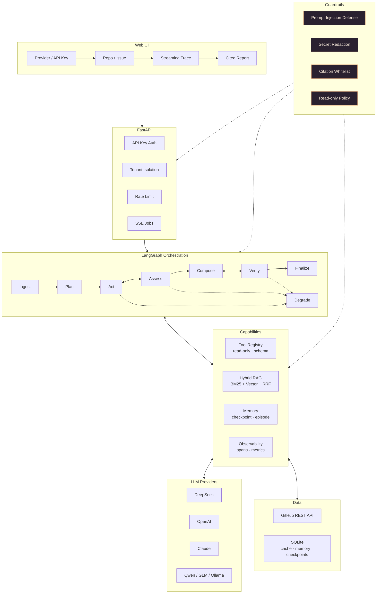

# 图片素材与绘制提示词

README / GitHub 仓库需要 5～6 张图。这里给出可直接投喂给图像模型（Nano Banana、
GPT-Image、即梦、Midjourney 等）的提示词，以及推荐尺寸和存放位置。

> **重要**：图像模型对文字（尤其中文小字）还原不稳定。**架构图、流程图优先用 Mermaid/SVG**
> （仓库里已有可渲染的 Mermaid 版本，见文末），图片模型只负责封面、Social Preview、
> UI 概念图这类"文字少"的素材。

---

## 0. 已收录素材

| 文件 | 用途 | 尺寸 |
|---|---|---|
| `docs/assets/logo.png` / `logo-256.png` / `favicon.ico` | Logo、favicon | 1024 / 256 / 16–64 |
| `docs/assets/social-preview.png` | README 顶部横幅、GitHub Social Preview | 1280×640 |
| `docs/assets/architecture.png` | 架构图 | 1920×1080 |
| `docs/assets/ui-preview.png` | 前端界面示意 | 1600×800 |

### 0.1 v2 改进版（针对首轮出图的问题）

首轮图整体可用，但有 5 处值得重绘：

| 图 | 首轮的问题 | v2 修正 |
|---|---|---|
| 架构图 | Orchestration 被做成**亮绿渐变块**，像按钮，破坏层级 | 改成与其它层一致的深色卡片，只用顶部 2px 薄荷青描边强调 |
| 架构图 | `Act ⇄ Assess` 的循环符号渲染成怪异的双向箭头 | 画成**两条独立曲线箭头**，分别标注 `need more evidence` 与 `back to act` |
| 架构图 | 右侧 `Budget / Error → Degrade` 贴近画布边缘，有裁切风险 | 降级节点收进画布内，右侧留 ≥8% 安全边距 |
| 架构图 | Web UI 层没体现 BYOK | 该层中间加一枚小胶囊 `BYOK key · not stored` |
| UI 概念图 | 流程只有 Plan/Act/Assess/Compose/Verify，与真实 7 节点不一致 | 显示 `Ingest → Plan → Act → Assess → Compose → Verify → Finalize`（可省略 Finalize 的耗时） |
| UI 概念图 | 报告结论没有"待验证"语义 | 每条加置信度标签 `LOW / MEDIUM`，报告标题下加一行 `Hypothesis, not a confirmed root cause` |
| 社交图 | 三个标签是 `Plan / Retrieve / Verify`，与状态机不一致 | 改为 `Plan / Act / Verify`，并加 `BYOK`、`LangGraph` 两个小标签 |
| Logo | 放大镜手柄比圆环略粗 | 统一 4px 描边；四周留 ≥10% 安全边距，缩放 32px 不变形 |

#### 架构图 v2 提示词

```text
为开源项目「Issue Triage Agent」绘制极简架构图，16:9，4K，深空蓝 #0B1220 背景，四周留白 ≥8%。

风格：扁平、深色卡片、1px 细描边、薄荷青 #4FD1B5 只用于强调（描边/图标/小标签），
禁止大面积渐变填充、禁止 3D、写实、插画、霓虹、多重阴影。

布局：自上而下 6 层，每层左侧有圆形层号 1~6；层间单线箭头；
最左侧独立窄栏 Guardrails，贯穿 2~5 层。

1 Web UI：Provider · API Key (BYOK, not stored) · Repo / Issue · Streaming Trace · Cited Report
2 API：FastAPI · API Key Auth · Tenant Isolation · Rate Limit · SSE Jobs
3 Orchestration（深色卡片 + 顶部 2px 薄荷青线，不要渐变）：
   Ingest → Plan → Act → Assess → Compose → Verify → Finalize
   Act 与 Assess 之间画两条独立曲线箭头，标注 "need more evidence" 和 "back to act"；
   Verify 回到 Compose 画一条虚线，标注 "unsupported → rewrite once"；
   右侧画一个深色小卡片 "Degrade"，用琥珀色 #F0B37E 虚线从 Act/Assess/Verify 指向它，
   标注 "budget / error"；该卡片必须完全在画布内。
4 Capabilities：四张等宽深色小卡
   Tool Registry（read-only · schema）｜Hybrid RAG（BM25 + Vector + RRF）
   ｜Memory（checkpoint · episode）｜Observability（spans · metrics）
5 Models：一行 5 个小胶囊 DeepSeek / OpenAI / Claude / Qwen / Ollama
6 Data：GitHub REST API · SQLite（cache · memory · checkpoints）

左下角加图例：实线=main path，虚线=loop/rewrite，琥珀虚线=degrade。
全部英文短标签，字号统一；负向：不要人物/机器人/水印/超过 40 个文字块。
```

#### UI 概念图 v2 提示词

```text
深色 Web 界面截图风格，1600×1000，深蓝 #0B1220 背景，三栏圆角卡片，薄荷青强调色，扁平无 3D。

左栏：标题 "Issue Triage"，副标题 "GitHub · read-only"；
输入 Repository、Issue Number；下拉 Model Provider 显示 "DeepSeek"（选项含 OpenAI / Claude）；
密码框 "API Key (BYOK · not stored)" 带锁图标；
主按钮 "Analyze"；底部小字 "Server default available"。

中栏：标题 "Workflow"，竖向时间线 7 个节点
Ingest → Plan → Act → Assess → Compose → Verify → Finalize，
每个节点一行耗时（如 0.4s / 0.8s / 2.6s / 0.9s / 1.4s / 0.7s / 0.3s）。

右栏：标题 "Triage Report"，副标题小字 "Hypothesis, not a confirmed root cause"；
两张结论卡：第一张标签 "LOW" 标题 "Likely duplicate"，正文一行，右上角引用角标 [1]；
第二张标签 "MEDIUM" 标题 "Suggested next step"，右上角 [2]；引用角标做成可点击的浅青下划线样式；
底部四枚指标胶囊 Rounds 3 · Tools 5 · Tokens 9.1K · Latency 6.4s。

文字英文、少而清晰；负向：不要人物、浏览器杂物、水印、超过 22 个文字元素。
```

#### 社交图 / Logo v2 增量

- **Social Preview**：把 `Plan / Retrieve / Verify` 改为 `Plan / Act / Verify`，
  另加 `BYOK` 与 `LangGraph` 两个胶囊；标题保持 `Issue Triage Agent`，
  副标题 `Agentic RAG for GitHub Issues`，底部 `MIT License`；整体元素 ≤12 个。
- **Logo**：统一描边宽度（建议 4/64 viewBox），四周 10% 安全边距，
  深色圆角方底，薄荷青线条，无文字、无渐变堆叠；导出 1024 / 256 / 32 三档。

---

## 1. 架构图（16:9，推荐 SVG/Mermaid，其次 AI 出图）

**文件**：`docs/assets/architecture.png`｜**尺寸**：3840×2160（16:9）

```text
为开源项目「GitHub Issue 排障 Agent」绘制一张极简技术架构图。

画布：16:9 横版，4K，深空蓝背景 #0B1220，四周留白，无外边框。
风格：扁平化、现代 SaaS 架构图，圆角矩形卡片、1px 细描边、低饱和薄荷青 #4FD1B5 主色，
雾蓝 #7FD8FF 辅色，琥珀 #F0B37E 仅用于"降级/失败"路径；禁止 3D、写实、照片、装饰插画、
霓虹、多重阴影。

布局：自上而下 6 层，层间细箭头；左侧一条贯穿 2～5 层的窄栏表示"安全护栏"。
所有标签使用英文短词（≤3 个单词），不要中文，保证文字清晰。

第 1 层 Web UI：Provider / API Key / Repo / Issue / Streaming Trace / Cited Report
第 2 层 API：FastAPI · API Key Auth · Tenant Isolation · Rate Limit · SSE Jobs
第 3 层 Orchestration（LangGraph）：Ingest → Plan → Act ⇄ Assess → Compose ⇄ Verify → Finalize，
        右侧一条虚线出口标注 "Budget / Error → Degrade"；Act 与 Assess 之间用双向虚线。
第 4 层 Capabilities（4 张并列卡片）：
        Tool Registry（read-only, schema-validated）｜Hybrid RAG（BM25 + Vector + RRF）
        ｜Memory（checkpoint / episode / fact）｜Observability（spans / metrics / logs）
第 5 层 Models：DeepSeek / OpenAI / Claude / Qwen / Moonshot / GLM / Gemini / Ollama，
        画成 4 个小胶囊即可，不要全部展开。
第 6 层 Data：GitHub REST API · SQLite（cache / memory / checkpoints）
左侧窄栏：Prompt-Injection Defense · Secret Redaction · Citation Whitelist · Read-only Policy

连线：主链路实线，循环/重写虚线，降级路径琥珀色虚线；箭头不穿透卡片。
负向：不要漫画风、不要人物/机器人、不要超过 35 个文字块、不要水印、不要中文长句。
```

> 如果你的模型仍然把文字画糊，直接用文末的 Mermaid 代码导出 SVG，效果最好。

---

## 2. GitHub Social Preview（1280×640）

**文件**：`docs/assets/social-preview.png`｜**尺寸**：1280×640

```text
为 GitHub 仓库绘制社交分享封面（Open Graph）。

画布 1280×640，深色背景 #0B1220，左侧 60% 放文字，右侧 40% 放图形。
风格：极简科技感、扁平插画、粗体无衬线字体、薄荷青 #4FD1B5 点缀，无照片、无 3D。

左侧文字层级（英文，务必清晰）：
主标题 80px：Issue Triage Agent
副标题 32px：Agentic RAG for GitHub Issues
一行小字 20px：Read-only tools · Cited answers · Multi-provider LLM

右侧图形：一个简洁的"放大镜 + 分支节点"图标，周围漂浮 3 个小标签：Plan、Retrieve、Verify；
线条极细，颜色薄荷青。
底部小角标：MIT License。
负向：不要人物、不要机器人、不要复杂背景纹理、不要超过 12 个文字元素。
```

---

## 3. README 顶部 Hero 横幅（1600×520）

**文件**：`docs/assets/hero.png`｜**尺寸**：1600×520

```text
极简抽象横幅，深色 #0B1220 到 #131C2B 的柔和渐变背景。
画面是一条从左到右流动的"证据链"：几个半透明圆角卡片节点被细线连接，
节点内有极简图标（文档、扳手、放大镜、对勾），线条与高光为薄荷青 #4FD1B5。
不要任何文字，不要人物、机器人、文字块、3D、霓虹、复杂纹理。
构图留白多，适合作为 README 顶部装饰图。
```

---

## 4. 前端界面概念图（1600×1000）

**文件**：`docs/assets/ui-preview.png`｜**尺寸**：1600×1000

```text
为开源项目绘制一张深色主题的 Web 界面截图风格概念图。

整体：深蓝 #0B1220 背景，三栏布局，圆角卡片，薄荷青强调色，现代 SaaS 风格，扁平 UI，
清晰的信息层级，不要 3D、不要玻璃拟态过曝、不要照片。

左侧栏（表单）：
- 标题 "GitHub Issue Triage"
- 两个输入框：Repository、Issue Number
- 一个下拉框，标签 "Model Provider"，选项包含 "DeepSeek / OpenAI / Claude"
- 一个密码输入框，标签 "API Key (BYOK, not stored)"
- 主按钮 "Analyze"

中间栏（执行轨迹）：竖向时间线，节点标签 Plan、Act、Assess、Compose、Verify，每条带耗时。

右侧栏（报告）：标题 "Triage Report"，两三条带引用角标的结论，底部一排指标胶囊
（Rounds、Tools、Tokens、Latency）。

文字尽量少且清晰，用英文；允许少量灰阶占位文本，但不要乱码。
负向：不要人物、不要浏览器边框外的杂物、不要水印、不要超过 20 个文字元素。
```

---

## 5. Agent 循环图（1600×900）

**文件**：`docs/assets/agent-loop.png`｜**尺寸**：1600×900

```text
绘制一张简洁的 Agent 工作流图，深色背景，扁平极简风格，薄荷青主色。

水平主链 7 个圆角节点，英文标签：
Ingest → Plan → Act → Assess → Compose → Verify → Finalize
其中 Act 与 Assess 之间画双向循环箭头，标注 "need more evidence"；
Verify 指回 Compose 画一条虚线，标注 "unsupported claim → rewrite once"；
从 Act 向右下方画一条琥珀色虚线到 "Degrade" 节点，标注 "budget / error"。

节点用细描边 + 轻微发光，箭头细且带方向；整体留白充足。
不要人物、机器人、3D、复杂图标；文字使用无衬线字体，字号统一，避免中文。
```

---

## 6. Logo / Favicon（1024×1024）

**文件**：`docs/assets/logo.png`（同时导出 256×256 作 favicon）

```text
一个极简的科技感 Logo 图标：放大镜轮廓内部是一条分叉的 git 分支线，
分支末端是一个小小的闪光点，象征"用 AI 定位问题"。

深色圆角方形底 #0B1220，线条为薄荷青 #4FD1B5，线宽均匀，几何精确，
扁平矢量风格，无渐变堆叠、无阴影、无文字。
适合缩小到 32×32 仍可辨识；负向：不要写实、不要复杂细节、不要字母。
```

---

## 7. 使用方式

1. 按上面的文件名生成图片，放到 `docs/assets/`；
2. README 顶部插入：
   ```markdown
   
   ```
3. 架构图放在「## 2. 架构」小节；
4. UI 概念图放在「## 4. 快速开始」之后，配一句"界面预览（示意）"；
5. GitHub 仓库 → **Settings → Social preview** 上传 `social-preview.png`；
6. 把 `logo.png` 缩成 32×32 的 `favicon.ico`（可选）。

> 标注"示意图"可以避免用户把概念图当成真实截图。

---

## 8. 附：可直接渲染的 Mermaid 架构图

把下面代码粘到 [Mermaid Live Editor](https://mermaid.live/) 或任何支持 Mermaid 的
Markdown 编辑器，即可导出 SVG（文字 100% 准确）：


